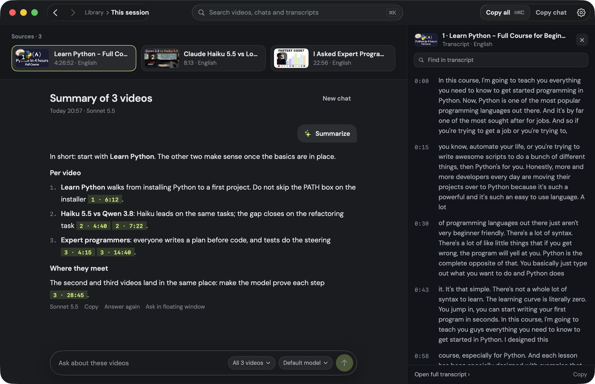

<p align="center">
  
</p>

<h1 align="center">Nab</h1>

<p align="center">
  <strong>Turn the video or pin in your browser into something an AI can read, or a file you keep.</strong><br>
  One shortcut grabs a YouTube transcript or a Pinterest photo or clip. Copy it as clean context, or ask questions and get answers that cite the moment.
</p>

<p align="center">
  <a href="https://github.com/tunatavsan/nab/actions/workflows/ci.yml"></a>
  <a href="LICENSE"></a>
  
  
</p>

<p align="center">
  
</p>

Nab lives in the menu bar. Press **⌃⌥N** while a YouTube video or a Pinterest pin is open in your browser and Nab reads
the tab's address and fetches the item. For a video it gets the details, chapters and transcript and puts that
context on the clipboard, ready to paste. For a pin it saves the photos and clips to a folder and puts the files on
the clipboard. Collect one item or twenty: **⌃⌥A** copies them, **⌃⌥S** opens a floating window to ask about the
front tab, **⌃⌥X** starts a fresh set. Nab works with the model you already use: Claude Code, Codex, the Anthropic or
OpenAI API, OpenRouter, or a local model through Ollama or LM Studio.

## Why Nab

- **No copy and paste.** The shortcut works from the browser you are in. Nab never opens a page, so there is nothing to
  scroll, expand or clean up.
- **Context, not a wall of text.** Every source is tagged, chapters are kept, and the transcript is grouped into
  timecoded passages, so a model can quote a moment and you can check it.
- **Answers you can verify.** In the chat, every claim carries its timecode. In a chat about one video, a click scrolls
  the transcript to the passage it rests on; ⌘-click, or any click in a chat about several videos, opens the video at
  that second.
- **The model you already use.** Pick the provider, the model and the answer language, and edit the system prompt and
  the summary request in Settings. API keys are kept in the macOS keychain.
- **Many at once.** Videos are fetched in parallel, and a request that stalls is retried on a fresh connection, so a
  batch of twenty takes seconds, not minutes.
- **Pins at full size.** Nab saves the original photo or the largest clip Pinterest offers a signed-out browser, not
  a downsized copy. Pages of a pin download in parallel: in a test, ten pins (photos, single clips and a
  five-clip idea pin, about 50 MB) went from one paste to all saved in under 3 seconds, about the time the
  single-purpose downloader Nab replaced took to keep only a still of each clip and a recompressed JPEG of each
  original.

## Features

| | |
| --- | --- |
| **Sources** | **YouTube** videos, read as a transcript with details and chapters. **Pinterest** pins, read as photos and clips at full size, including idea pins (every page), carousels and `pin.it` share links. A new source is one target and one line; see [ARCHITECTURE.md](ARCHITECTURE.md). |
| **Capture** | ⌃⌥N takes the front tab of Safari, Chrome, Arc, Brave, Edge, Vivaldi, Opera, Dia, Comet or Helium. Paste any number of links at once, or drive Nab from Shortcuts, Raycast and scripts through `nab://` URLs. |
| **Photos and clips** | A pin's photos and clips are saved as files in the media folder while its card shows **Saving…** and a percentage. A pin you nab again is not downloaded twice, and a file you moved or deleted is saved again. See [Photos and clips](#photos-and-clips). |
| **Copy and drag** | Copy, or drag a card, and the next app gets what suits the item: a pin's photos and clips as files (a single photo also as picture data), a video as its context pack. A session with a video in it copies as one context pack that lists the pins' files by name. Every copy works the same way, from a shortcut, a button, a menu or the search palette; when a saved file is gone, nothing goes on the clipboard and the rack offers **Save again**. |
| **Sessions** | Videos nabbed close together form a session. A rack under the menu bar icon deals each one in as it arrives and the icon counts them. Copying or summarizing a session, ⌃⌥X, or five quiet minutes start the next one, and the library keeps each set together. |
| **Transcript** | Details, chapters and captions in the video's original language, even when YouTube offers dubbed tracks, preferring a human-made track over automatic captions. |
| **Context pack** | One block of text for any number of videos: tagged sources, an index, chapters, the description and the timecoded transcript. Copy it, or export it as Markdown. |
| **Chat** | Summarize a video or a whole session, then keep asking. Answers stream in, cite timecodes and are saved with the video. |
| **Player** | Click a timecode and the video plays from that moment: in its browser tab if it is already open there, otherwise on its page in the library, with the player on top. Pin the player to keep it floating above other apps; while it is pinned, timecodes play there. With **Play videos in** set to Browser, a new tab opens instead of the library. ⌘-click opens the transcript at the moment. |
| **Library** | One window, four pages. **Home** lists the open session and earlier ones by day, with their chats. A **session page** holds the chat and, beside it, a transcript drawer that opens from a source card or a timecode. A **video page** shows chapters and the transcript, with find (⌘F) and a timeline. **Settings** is the fourth. ⌘[ and ⌘] go back and forward. |
| **Search** | ⌘K searches video titles, chats and transcript lines, and jumps to the moment. |
| **Ask window** | ⌃⌥S reads the front tab. If it is a video or a pin, Nab adds it and opens a floating glass window near the top of the screen on that one item, with the question field focused. Nothing is sent until you ask or press **Summarize** (⌘↩). Without a supported tab, it opens on the open session, or on the latest item when the session is empty. A question typed while the item is still loading goes out as soon as it arrives. Esc closes it, ⇥ switches between the item and the session, ⌘O opens the chat in the library and ⌘C copies the answer. |
| **Menu bar** | The icon opens a panel with the session and its Copy all, Ask AI and New session buttons, plus paste, export, the library and Settings. Right-click it to switch to a monochrome icon, reopen the welcome or quit. The rack under the icon shows what a shortcut just did. |
| **Welcome** | The first launch walks through the shortcuts, picking an AI and where videos play, inside the library window. |
| **Command line** | `nab <links>` prints the same context pack for videos and pins, for scripts and agents. `--save <folder>` also saves the pins' photos and clips. |

## Getting started

Nab is an early preview. Signed and notarized downloads are not available yet, so for now you build it from source.

**Requirements:** macOS 26 or later and Xcode 26 or later (Swift 6.2).

```sh
git clone https://github.com/tunatavsan/nab.git
cd nab
scripts/build.sh --run
```

`scripts/build.sh` builds a release copy into `dist/Nab.app`, signs it and, with `--run`, opens it. It signs with the
first Apple Development or Developer ID identity in your keychain, or ad hoc when there is none; set
`NAB_SIGN_IDENTITY` to choose one. macOS ties the browser permission to the signature, so an ad hoc build may ask for
it again after every rebuild. `scripts/build.sh --install` replaces `/Applications/Nab.app` with the new build and
opens it.

### Choosing a model

Open **Settings** (⌘,) in the library window and pick a provider:

| Provider | What you need |
| --- | --- |
| Claude Code | The `claude` command, signed in. Nab runs it in your login shell from an empty folder. |
| Codex CLI | The `codex` command, signed in. |
| Anthropic API, OpenAI API, OpenRouter | An API key, stored in your keychain. |
| Ollama, LM Studio | The local server running with a model loaded. Nothing leaves your Mac. |
| OpenAI-compatible server | Its address, and a key if it needs one. |

**Test** sends a one-word question so you know the setup works before you ask a real one. For Claude Code and Codex,
Settings shows whether the command is installed and signed in, with the official command to copy when it is not, and
an effort menu next to the model. The first summary you start without having picked a provider asks you to pick one,
then runs.

### Photos and clips

Pinterest items are saved as files. The folder is **~/Downloads/Nab** unless you pick another one in **Settings ›
Downloads › Save photos and videos to**. A file is named after the pin and says where it came from, with a number for
each page of a pin that has several:

```
Autumn table (Pinterest 123456789012345678).png
Trail map (Pinterest 123456789012345678) 2.mp4
```

Slashes and colons in a title become hyphens and a name is at most 100 characters. If a file with that name is
already in the folder, Nab uses it and does not download it again. A download arrives in a temporary file and takes
its name only when it is whole, so a name in the folder is always a complete file. Nab never writes over a file: if
the name holds something else (a file you edited, one cut short), the new copy is saved next to it as `… (2).jpg`. A
saved file you edit stays yours and is copied as it is. Removing an item from the library never deletes its files:
they are yours.

Nab saves the original photo, and the largest of a clip's plain MP4 files. A clip Pinterest offers only as a stream
is reported, not saved. Music in an idea pin is not saved.

### Permissions

| Permission | Needed for |
| --- | --- |
| Automation (your browser) | Reading the address and title of the front tab when you press ⌃⌥N, and, when videos play in the browser, finding the video's tab and moving it to the moment. macOS asks the first time. |

You can review it in **System Settings › Privacy & Security › Automation**.

### What leaves your Mac

Nab sends requests to YouTube to read a video, to Pinterest to read a pin and download its photos and clips, and to
the AI provider you choose when you summarize or ask a question. The Pinterest requests carry no cookie and no
account: Nab never signs in and never reads your browser's cookies. They go to `www.pinterest.com` (the pin's
details), `api.pinterest.com` (to follow a `pin.it` share link) and `pinimg.com` hosts (the files).
The provider receives the item's details and your chat with it: a video's transcript, or a pin's title and
description. A pin's photos and clips are not sent to the provider. Its context pack names each saved file, never the
folder it is in. Nab has no account, no analytics and no server of its own. Your library and chats are stored as JSON
files in `~/Library/Application Support/Nab`; saved photos and clips are in the media folder.

### Keyboard shortcuts

| Shortcut | Does |
| --- | --- |
| ⌃⌥N | Nab the front browser tab. |
| ⌃⌥A | Copy the session: its photos and clips as files, or one context pack when a video is among them. |
| ⌃⌥S | Open or close the ask window on the front tab's item. It sends nothing. |
| ⌃⌥X | Start a fresh session. |
| ⌘K | Search the library (in the library window). |
| ⌘, | Open Settings. |
| ⌘[ and ⌘] | Back and forward. |
| ⌘F | Find in the transcript (video page). |
| ⌘↩ | Summarize, in an empty chat. |
| ⇧⌘V | Add every YouTube and Pinterest link on the clipboard. |
| ⇧⌘C | Copy the page's items: photos and clips as files, one context pack when a video is among them. |
| ⌘J | Ask AI about the current page. |

**Settings › Shortcuts** records your own combination for any of the four global shortcuts. Settings also has **New
session after**: how many quiet minutes (1 to 60, five by default) end a session.

## Command line and URLs

The app bundle contains the `nab` command:

```sh
Nab.app/Contents/Resources/nab "https://youtu.be/…" "https://www.youtube.com/watch?v=…"   # context pack
Nab.app/Contents/Resources/nab --json "https://youtu.be/…"                                 # structured data
Nab.app/Contents/Resources/nab --save ~/Pins "https://pin.it/…" "https://www.pinterest.com/pin/…/"   # pack, and the files
```

`--save <folder>` saves each pin's photos and clips in that folder, with the names described in [Photos and
clips](#photos-and-clips), and the pack lists the saved files by name. `--json` prints the captures as JSON; a pin's
photos and clips are under `media` (kind, source address, size, length and, with `--save`, the saved path). Links
are read in parallel, `pin.it` links are followed first, and the exit code is non-zero when any link, short link or
save fails.

| URL | Does |
| --- | --- |
| `nab://front` | What ⌃⌥N does. |
| `nab://add?url=…` | Adds one or more links (repeat `url=`). |
| `nab://chat?url=…` | Adds the links (a `pin.it` link is followed first), waits for them, then opens the ask window on them. Press Summarize to send. |
| `nab://copy` | What ⌃⌥A does: copies the session's context. |
| `nab://summarize` | Opens the ask window on the session. It sends nothing until you press Summarize. |
| `nab://ask` | Opens the ask window on the session (or the latest video) with the field focused. It sends nothing. |
| `nab://ask?q=…` | Opens the ask window with that text in the field. It does not send; you press Return. |
| `nab://close` | What ⌃⌥X does: starts a fresh session. |
| `nab://menu` | Opens the menu bar panel. |
| `nab://library` | Opens the library. |
| `nab://library?id=…` | Opens the library on that video. |
| `nab://library?session=current` | Opens the library on the open session's chat. |
| `nab://settings` | Opens the Settings page. |
| `nab://search?q=…` | Opens the ⌘K search with that text. |

## Development

Nab is a Swift package with no Xcode project and no third-party code, so a build never downloads anything.

```sh
swift build          # build everything
swift test           # run the tests
scripts/format.sh    # format the sources with swift-format
scripts/check.sh     # what CI runs: formatting, a build that treats warnings as errors, then every test
```

| Target | Purpose |
| --- | --- |
| `NabCore` | The data model, the source protocol and registry, the context pack, conversations and the library store, the media folder and file names, and the shared photo and clip downloader. No UI. |
| `NabYouTube` | Reads a YouTube video: details, caption tracks, captions and chapters. |
| `NabPinterest` | Reads a Pinterest pin: details, photos and clips, idea pins, carousels and share links. |
| `NabSources` | The one list of sources the app and the command line read from. |
| `NabAI` | Providers, settings and the keychain: one streaming client for HTTP APIs and command-line tools. |
| `NabApp` | The menu bar app: shortcuts, browser bridge, session rack, library pages, ask window, search, chat, settings and the design system. |
| `NabCLI` | The `nab` command. |

For debugging, `NAB_DATA_DIR` points Nab at another data folder, and `NAB_OPEN='nab://…'` handles that URL at launch (debug builds only).

[ARCHITECTURE.md](ARCHITECTURE.md) explains how a capture and a chat flow through these parts, and how to add a new
source.

Nab reads YouTube through the same player interface the YouTube app uses, and Pinterest through the requests its
signed-out web pages make. Neither is a public API and either can change; when one does, `YouTubeSource` or
`PinterestSource` is the one place to update. Nab is not affiliated with YouTube, Google or Pinterest.

## Roadmap

- [ ] Signed, notarized releases and a Homebrew cask
- [ ] An MCP server, so agents can search and read your library
- [ ] More sources: X and Instagram
- [ ] PDF reports of summaries
- [ ] A Turkish interface

Ideas and bug reports are welcome in [Issues](https://github.com/tunatavsan/nab/issues).

## Contributing

Contributions are welcome. Please read [CONTRIBUTING.md](CONTRIBUTING.md) before opening a pull request, and report
security or privacy problems privately as described in [SECURITY.md](SECURITY.md).

## License

Nab is released under the [MIT License](LICENSE). Third-party components are listed in
[THIRD-PARTY-NOTICES.md](THIRD-PARTY-NOTICES.md).
