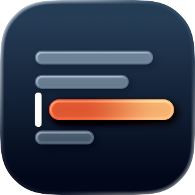
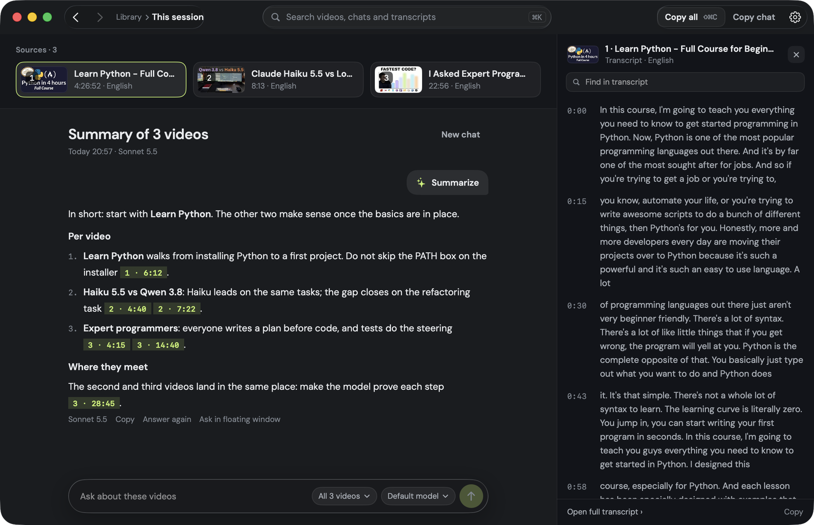

<p align="center">
  
</p>

<h1 align="center">Nab</h1>

<p align="center">
  <strong>Turn the video in your browser into something an AI can read.</strong><br>
  One shortcut grabs the transcript. Copy it as clean context, or ask questions and get answers that cite the moment.
</p>

<p align="center">
  <a href="https://github.com/tunatavsan/nab/actions/workflows/ci.yml"></a>
  <a href="LICENSE"></a>
  
  
</p>

<p align="center">
  
</p>

Nab lives in the menu bar. Press **⌃⌥N** while a YouTube video is open in your browser and Nab reads the tab's
address, fetches the video's details, chapters and transcript, and puts its context on the clipboard, ready to paste.
Collect one video or twenty: **⌃⌥A** copies them as a single context pack, **⌃⌥S** opens the library and summarizes
them in a floating window, **⌃⌥X** starts a fresh set. Nab works with the model
you already use: Claude Code, Codex, the Anthropic or OpenAI API, OpenRouter, or a local model through Ollama or
LM Studio.

## Why Nab

- **No copy and paste.** The shortcut works from the browser you are in. Nab never opens a page, so there is nothing to
  scroll, expand or clean up.
- **Context, not a wall of text.** Every source is tagged, chapters are kept, and the transcript is grouped into
  timecoded passages, so a model can quote a moment and you can check it.
- **Answers you can verify.** In the chat, every claim carries its timecode. In a chat about one video, a click scrolls
  the transcript to the passage it rests on; ⌘-click, or any click in a chat about several videos, opens the video at
  that second.
- **The model you already use.** Pick the provider, the model and the answer language, and edit the system prompt and
  the summary request in Settings. API keys are kept in the macOS keychain.
- **Many at once.** Videos are fetched in parallel, and a request that stalls is retried on a fresh connection, so a
  batch of twenty takes seconds, not minutes.

## Features

| | |
| --- | --- |
| **Capture** | ⌃⌥N takes the front tab of Safari, Chrome, Arc, Brave, Edge, Vivaldi, Opera, Dia, Comet or Helium. Paste any number of links at once, or drive Nab from Shortcuts, Raycast and scripts through `nab://` URLs. |
| **Sessions** | Videos nabbed close together form a session. A rack under the menu bar icon deals each one in as it arrives and the icon counts them. Copying or summarizing a session, ⌃⌥X, or five quiet minutes start the next one, and the library keeps each set together. |
| **Transcript** | Details, chapters and captions in the video's original language, even when YouTube offers dubbed tracks, preferring a human-made track over automatic captions. |
| **Context pack** | One block of text for any number of videos: tagged sources, an index, chapters, the description and the timecoded transcript. Copy it, or export it as Markdown. |
| **Chat** | Summarize a video or a whole session, then keep asking. Answers stream in, cite timecodes and are saved with the video. |
| **Library** | One window, four pages. **Home** lists the open session and earlier ones by day, with their chats. A **session page** holds the chat and, beside it, a transcript drawer that opens from a source card or a timecode. A **video page** shows chapters and the transcript, with find (⌘F) and a timeline. **Settings** is the fourth. ⌘[ and ⌘] go back and forward. |
| **Search** | ⌘K searches video titles, chats and transcript lines, and jumps to the moment. |
| **Ask window** | ⌃⌥S opens a floating glass window near the top of the screen without leaving your browser. It asks about the open session, or the latest video when the session is empty. Ask follow-ups there. Esc closes it, ⇥ switches between session and latest video, ⌘O opens the chat in the library and ⌘C copies the answer. |
| **Menu bar** | The icon opens a panel with the session and its Copy all, Ask AI and New session buttons, plus paste, export, the library and Settings. The rack under the icon shows what a shortcut just did. |
| **Command line** | `nab <links>` prints the same context pack, for scripts and agents. |

## Getting started

Nab is an early preview. Signed and notarized downloads are not available yet, so for now you build it from source.

**Requirements:** macOS 26 or later and Xcode 26 or later (Swift 6.2).

```sh
git clone https://github.com/tunatavsan/nab.git
cd nab
scripts/build.sh --run
```

`scripts/build.sh` builds a release copy into `dist/Nab.app`, signs it and, with `--run`, opens it. It signs with the
first Apple Development or Developer ID identity in your keychain, or ad hoc when there is none; set
`NAB_SIGN_IDENTITY` to choose one. macOS ties the browser permission to the signature, so an ad hoc build may ask for
it again after every rebuild. `scripts/build.sh --install` replaces `/Applications/Nab.app` with the new build and
opens it.

### Choosing a model

Open **Settings** (⌘,) in the library window and pick a provider:

| Provider | What you need |
| --- | --- |
| Claude Code | The `claude` command, signed in. Nab runs it in your login shell from an empty folder. |
| Codex CLI | The `codex` command, signed in. |
| Anthropic API, OpenAI API, OpenRouter | An API key, stored in your keychain. |
| Ollama, LM Studio | The local server running with a model loaded. Nothing leaves your Mac. |
| OpenAI-compatible server | Its address, and a key if it needs one. |

**Test** sends a one-word question so you know the setup works before you ask a real one.

### Permissions

| Permission | Needed for |
| --- | --- |
| Automation (your browser) | Reading the address and title of the front tab when you press ⌃⌥N. macOS asks the first time. |

You can review it in **System Settings › Privacy & Security › Automation**.

### What leaves your Mac

Nab sends requests to YouTube to read a video, and to the AI provider you choose when you summarize or ask a question.
The provider receives the video's details and transcript and your chat with it. Nab has no account, no analytics and
no server of its own. Your library and chats are stored as JSON files in `~/Library/Application Support/Nab`.

### Keyboard shortcuts

| Shortcut | Does |
| --- | --- |
| ⌃⌥N | Nab the front browser tab. |
| ⌃⌥A | Copy the session's context pack. |
| ⌃⌥S | Open or close the ask window on the session. |
| ⌃⌥X | Start a fresh session. |
| ⌘K | Search the library (in the library window). |
| ⌘, | Open Settings. |
| ⌘[ and ⌘] | Back and forward. |
| ⌘F | Find in the transcript (video page). |
| ⇧⌘V | Add every YouTube link on the clipboard. |
| ⇧⌘C | Copy the page's videos as a context pack. |
| ⌘J | Ask AI about the current page. |

Settings also has **New session after**: how many quiet minutes (1 to 60, five by default) end a session.

## Command line and URLs

The app bundle contains the `nab` command:

```sh
Nab.app/Contents/Resources/nab "https://youtu.be/…" "https://www.youtube.com/watch?v=…"   # context pack
Nab.app/Contents/Resources/nab --json "https://youtu.be/…"                                 # structured data
```

| URL | Does |
| --- | --- |
| `nab://front` | What ⌃⌥N does. |
| `nab://add?url=…` | Adds one or more links (repeat `url=`). |
| `nab://chat?url=…` | Adds the links, waits for them, then opens the ask window on them. Press Summarize to send. |
| `nab://copy` | What ⌃⌥A does: copies the session's context. |
| `nab://summarize` | Opens the ask window on the session. Unlike ⌃⌥S it sends nothing until you press Summarize. |
| `nab://ask` | Opens the ask window on the session (or the latest video) with the field focused. It sends nothing. |
| `nab://ask?q=…` | Opens the ask window with that text in the field. It does not send; you press Return. |
| `nab://close` | What ⌃⌥X does: starts a fresh session. |
| `nab://menu` | Opens the menu bar panel. |
| `nab://library` | Opens the library. |
| `nab://library?id=…` | Opens the library on that video. |
| `nab://library?session=current` | Opens the library on the open session's chat. |
| `nab://settings` | Opens the Settings page. |
| `nab://search?q=…` | Opens the ⌘K search with that text. |

## Development

Nab is a Swift package with no Xcode project and no third-party code, so a build never downloads anything.

```sh
swift build          # build everything
swift test           # run the tests
scripts/format.sh    # format the sources with swift-format
scripts/check.sh     # what CI runs: formatting, a build that treats warnings as errors, then every test
```

| Target | Purpose |
| --- | --- |
| `NabCore` | The data model, the source registry, the context pack, conversations and the library store. No UI, no network. |
| `NabYouTube` | Reads a YouTube video: details, caption tracks, captions and chapters. |
| `NabAI` | Providers, settings and the keychain: one streaming client for HTTP APIs and command-line tools. |
| `NabApp` | The menu bar app: shortcuts, browser bridge, session rack, library pages, ask window, search, chat, settings and the design system. |
| `NabCLI` | The `nab` command. |

For debugging, `NAB_DATA_DIR` points Nab at another data folder, and `NAB_OPEN='nab://…'` handles that URL at launch (debug builds only).

[ARCHITECTURE.md](ARCHITECTURE.md) explains how a capture and a chat flow through these parts, and how to add a new
source.

Nab reads YouTube through the same player interface the YouTube app uses. It is not a public API and it can change;
when it does, `YouTubeSource` is the one place to update. Nab is not affiliated with YouTube or Google.

## Roadmap

- [ ] Signed, notarized releases and a Homebrew cask
- [ ] An MCP server, so agents can search and read your library
- [ ] More sources: podcasts, X and Instagram videos
- [ ] PDF reports of summaries
- [ ] A Turkish interface

Ideas and bug reports are welcome in [Issues](https://github.com/tunatavsan/nab/issues).

## Contributing

Contributions are welcome. Please read [CONTRIBUTING.md](CONTRIBUTING.md) before opening a pull request, and report
security or privacy problems privately as described in [SECURITY.md](SECURITY.md).

## License

Nab is released under the [MIT License](LICENSE). Third-party components are listed in
[THIRD-PARTY-NOTICES.md](THIRD-PARTY-NOTICES.md).
